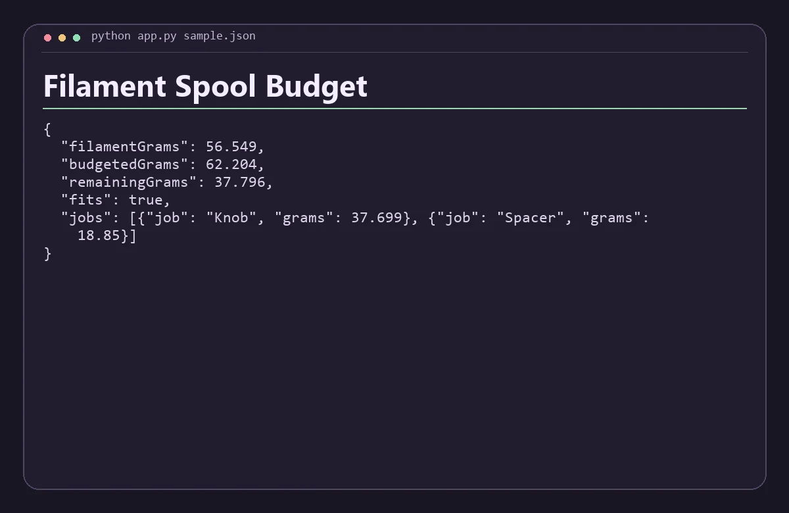

# Filament Spool Budget

Estimate filament mass for a queue of 3D prints from measured extrusion lengths and material density.



## Run

Install Python 3.11 or newer. Run these commands from the repository root.

```sh
python app.py sample.json
```

Replace `sample.json` with a JSON file following the same structure. The app prints a JSON report to standard output.

Supply filament diameter in millimeters, density in grams per cubic centimeter, and each job's estimated extruded meters. Waste is added as a fraction of the calculated mass.

## Verify

Run `python check.py` with Python 3.11 or newer after the build step when applicable. The check verifies the bundled scenario and confirms that an invalid input returns an error.
